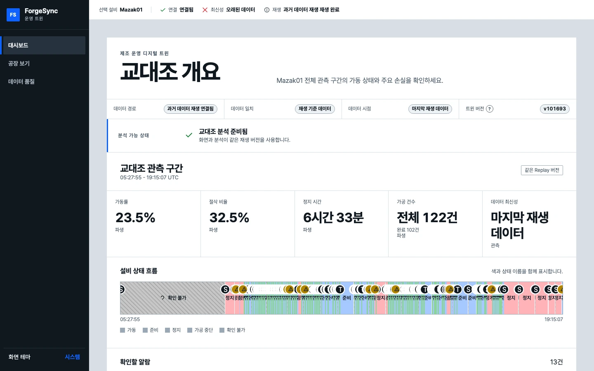
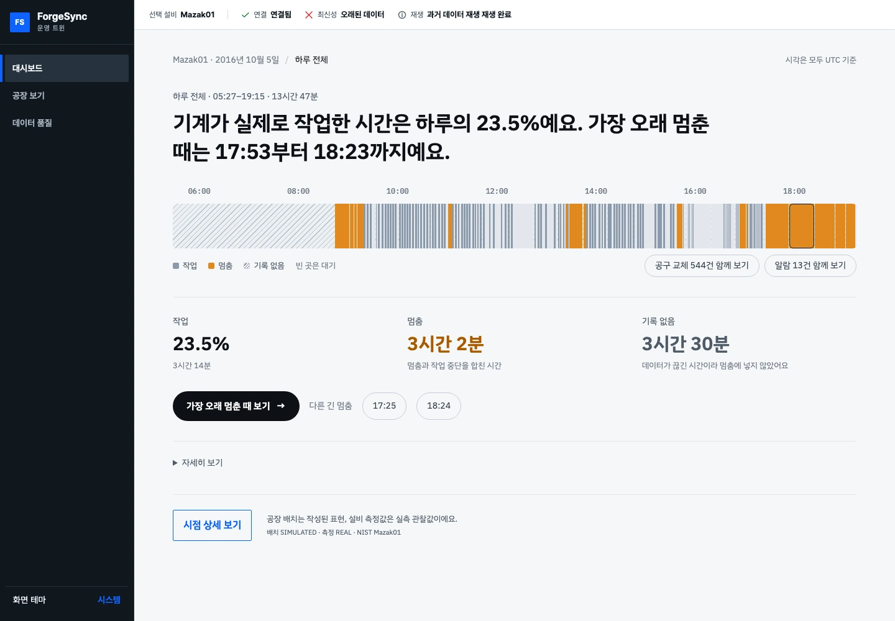
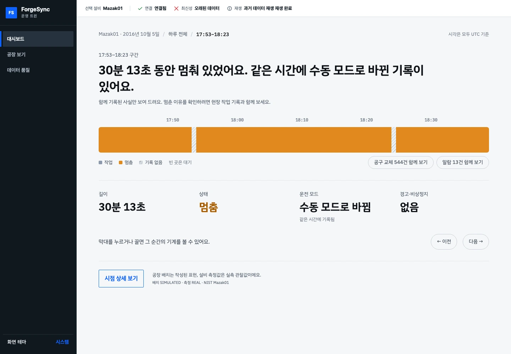
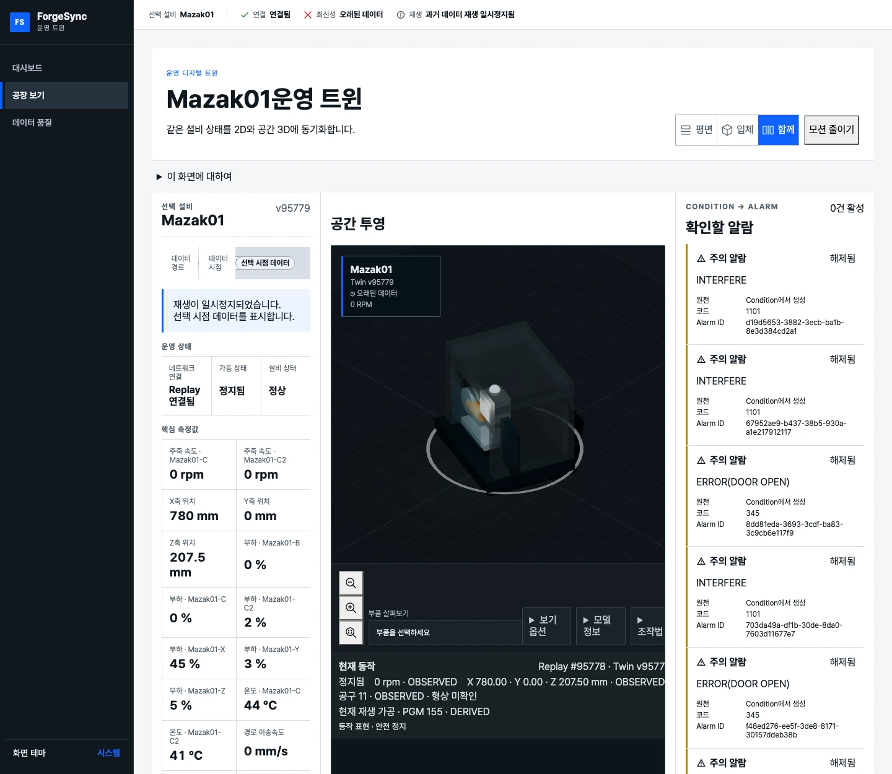

## 맥락

기록이 없는 시간을 정지 시간에서 제외하고, 선택한 구간의 설비 상태와 원본 기록을 조회하는 화면 구현. 정지·가공 시간 변화 구간을 조사하는 엔지니어를 가정한 기능.

제조지능화 아카데미와 자료 조사를 바탕으로 한 개인 학습 프로젝트. 현장 인터뷰 없이 NIST 공개 CNC 설비 1대의 하루 기록 활용.

## 판단

기록이 끊긴 시간과 실제 정지 시간의 구분 필요. 알람과 정지가 같은 시점에 기록되더라도, 원인으로 단정하지 않고 함께 발생한 사실로 표시.

품질 원천 데이터가 없는 항목은 불량률·종합 효율 산출에서 제외.

기존 분석에서는 평소 변동 폭이 작은 센서의 미세한 차이가 큰 점수로 계산되고, 여러 센서 중 가장 큰 편차가 전체 판정을 좌우하는 문제 발견.

실제 정상·불량 정답이 없는 조건에서 가공 시간의 편차를 중심 기준으로 선택. 센서값의 편차는 원인 조사를 위한 참고 정보로 제공.

## 실행

원본 보존, 공통 형식 변환, 기록 재생, 상태 저장과 화면 구현 담당. AI 코딩 에이전트를 활용하고 도메인 규칙과 검증 체계는 직접 설계.

화면의 조회 순서는 하루 상태 요약 → 관심 구간 선택 → 당시 상태와 원본 기록 확인. 요약에서는 작업·멈춤·기록 없음을 구분.

### 개선 전: 구분되지 않던 기록

기록이 없는 시간까지 정지로 읽히던 기존 화면. 많은 수치가 동시에 표시되어 우선 확인할 항목이 불분명한 구성. [화면 크게 보기](../../images/forgesync-before.webp)

### 개선 후: 작업·멈춤·기록 누락을 분리

기존 포트폴리오에 수록한 실제 화면. 수치는 해당 공개 기록과 당시 계산 조건에 따른 결과. [화면 크게 보기](../../images/forgesync-overview.webp)

### 관심 구간에서 당시 기록으로

선택 구간의 운전 모드·경고·측정 기록 확인. 같은 시점의 경고와 정지 원인은 구분. [화면 크게 보기](../../images/forgesync-detail.webp)

측정 기록을 반영한 상태 표시와 가상의 3D 배치·설비 모형. 실측 데이터와 시각화용 가정의 구분. [화면 크게 보기](../../images/forgesync-factory.webp)

## 확인

가공 시간과 센서값의 역할을 구분한 판정 코드·테스트 작성. 저장소에 기록 전달의 중복·순서 뒤바뀜을 다루는 설계와 평가 기록 포함.

**실제 정상·불량 정답이 없어 탐지 정확도 개선은 미검증.** 판정 구조의 수정과 실제 고장 탐지 성능의 구분.

## 한계와 다음 단계

공개 설비 1대의 하루 기록으로 검증 범위 제한. 실제 현장 요구·사용성, 여러 설비와 기간에서의 적용 가능성은 미검증. 가공 시간 편차와 고장·불량 판정의 구분 필요.

후속 과제는 현장 작업 기록과의 대조, 엔지니어의 의심 구간 탐색·기록 조회 과정에 대한 사용성 검증.
